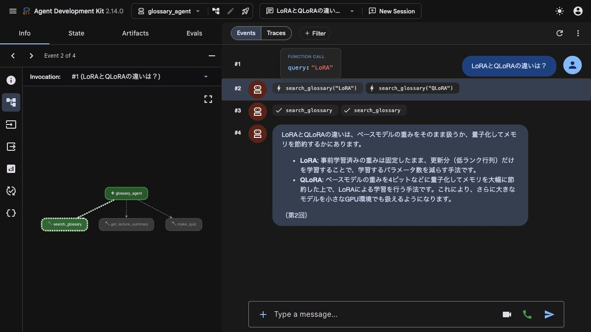

# 第3回 解答

## 演習

- 第1回（素のLLM）とエージェントの回答の違い：第1回と同じ「AIE2026の講座の宿題にある『3レベル』とは何ですか？」を、同じモデルで改めて比較した。素のLLMは、推測と断りつつ「基礎・応用・発展」など複数の一般的な解釈を挙げた。一方、エージェントは `search_glossary(query="3レベル")` を使い、正式な名称である「基礎・実装・発展」と、「どれか1つに取り組めば完了」という講座のルールを答えた。
- 演習資料の `lecNN-start タグ` の質問も比較した。素のLLMは、教材内の開始地点を示すアンカータグと説明し、受講者が特別な操作をする必要はほとんどないと述べた。エージェントは `search_glossary(query="lecNN-start タグ")` を使い、「各回の演習開始時点のコードに付けたGitタグで、前の回が終わっていなくても、そのタグからブランチを作って演習を始められる」と答えた。講座固有の情報は、一般知識から推測するよりも資料を検索して答える方が正確だった。
- `--trace` と同じ `print_trace` で見えたツール呼び出し：`LoRAとQLoRAの違いは？` に対し、`search_glossary(query="LoRA")` と `search_glossary(query="QLoRA")` が呼ばれ、それぞれの結果がモデルに返された。
- 1つの質問でのLLM呼び出し回数：上記の比較質問では `requests=2`。1回目のモデル応答に2件のツール呼び出しが含まれ、結果を受け取った後、2回目で最終回答を作った。ツールの呼び出し件数と、LLMの呼び出し回数は同じではない。今回のPydantic AI版6問はすべて `requests=2` だった。
- 追加したツール：`app/tools.py` の `make_quiz(lecture: int)`。指定した回の用語集の先頭の用語を選び、問題と用語集にある模範解答を返す。該当する回の用語がない場合は、その旨を返して問題を作らない。比較しやすいように選ぶ用語は固定したので、繰り返すと同じ問題になる。
- docstringには、復習用の確認問題を求められたときに使うこと、回は1始まりの整数で指定すること、利用者が解答を求めるまでは問題だけを見せることを書いた。実際に `make_quiz(lecture=2)` が呼ばれ、「事前学習」の確認問題が出た。Pydantic AI版・ADK版ともに、この試行では模範解答を先に表示しなかった。

## 宿題

- 取り組んだレベル：**発展(a)**
- やったこと：演習の学習支援エージェントをGoogle ADKで組み立て直した。`adk_agent/glossary_agent/agent.py` と `__init__.py` を追加し、Pydantic AI版と同じ `INSTRUCTIONS`、`search_glossary`、`get_lecture_summary`、`make_quiz` を直接再利用した。指示文・用語集・検索処理は比較のために書き換えていない。`app/` の変更は演習の `make_quiz` の追加・登録のみ。
- 実施方法：実装、APIでの実行、ブラウザでの画面確認、ログの保存をAIツールで行い、出力原文とツールの実行記録を確認して以下にまとめた。

### 実験条件

| 項目 | 設定 |
|---|---|
| 実行日時 | 2026年11月9日 1時46分〜1時53分（日本時間、画面確認を除く） |
| 環境 | ローカルのPython 3.12.15。Codespacesでは実行していない |
| モデル | 両方とも `gemini-3.5-flash-lite` |
| ライブラリ | Pydantic AI Slim 2.57.0、Google ADK 2.14.0、google-genai 2.31.0 |
| 指示・ツール・データ | 同じ指示文と3つの関数を再利用。用語集と講義の要点も共通 |
| 試行数 | 6問を両方で各1回。比較用に素のLLMを2問、計14実行。ADK画面確認は別に1実行 |
| 会話履歴 | 毎回、新しい独立した実行。ADKは `adk run --in_memory --jsonl` を使用 |
| 生成設定 | temperature・出力上限・思考設定はSDKとモデルの既定値。明示的には統一していない |
| 実行順・間隔 | エージェント12実行の順番をseed=42でシャッフル。開始間隔は最低20秒 |
| 上限・再試行 | Pydantic AIは1問の論理リクエスト上限6回、ADK CLIは1問60秒。実験側の自動再試行なし。SDK内部の再試行は既定値 |

ADKは `uv run --with google-adk==2.14.0` で一時的に追加した。講座の `pyproject.toml` と `uv.lock` は変更していない。

質問全文・実行順・設定・ソースのハッシュは [run.json](results/20261109-014654/run.json)、回答・ツール名・引数・ツールの返り値は [results.jsonl](results/20261109-014654/results.jsonl) に保存した。Pydantic AIのメッセージ原文は同じフォルダの `pydantic_*.json`、ADK CLIの出力原文は `adk_*.txt` にある。

ADK 2.14.0は `--jsonl` を指定しても冒頭にログファイルの案内を出したため、最初の集計で `JSONDecodeError` が出た。読み取り処理を修正して保存済みの出力を集計し直した。APIを再実行したものではなく、原文と初回集計エラーの記録も残している。

### 書き方の比較

| 観点 | Pydantic AI版 | ADK版 |
|---|---|---|
| エージェントの生成 | `Agent(instructions=INSTRUCTIONS)` | `Agent(name="glossary_agent", model=MODEL, instruction=INSTRUCTIONS, tools=[...])` |
| ツールの登録 | `agent.tool_plain(関数)` で1つずつ登録 | `tools` に同じ関数のリストを渡す |
| モデルの指定 | `run_sync` の実行時に `GoogleModel` を渡す | `root_agent` の生成時に指定 |
| 実行 | `agent.run_sync(...)`。CLIは `python -m app.agent --trace ...` | `root_agent` を公開し、`adk run` または `adk web` で実行 |
| 動きの確認 | `print_trace` で呼び出し・返り値・usageを表示 | CLIのイベント出力や、Web画面のEventsで確認 |

エージェントを組み立てる部分は変わったが、用語を調べる処理はそのまま使えた。ツールがフレームワーク固有のオブジェクトを受け取らない普通の関数になっていたことで、移し替えが小さな変更で済んだ。

ただし、ADK版も `INSTRUCTIONS` を `app.agent` から読み込むため、Pydantic AIへの依存は残っている。今回は同じ指示を再利用する比較課題なのでこの形にしたが、将来ADK版だけを独立して動かすなら、共通の指示文を別の軽いモジュールに分ける方が保守しやすい。

### 同じ質問への結果

以下は回答原文を用語集・講義の要点と照合した要約である。APIの成功と回答の正確さは分けて確認した。

| 質問の内容 | Pydantic AIのツール呼び出し | ADKのツール呼び出し | 回答を比べた結果 |
|---|---|---|---|
| 宿題の「3レベル」 | `search_glossary("3レベル")` | 同左 | 両方とも「基礎・実装・発展」と、どれか1つで完了することを説明した |
| `lecNN-start タグ` | `search_glossary("lecNN-start タグ")` | 同左 | 両方とも演習開始時点のGitタグであり、そこからブランチを作れると説明した |
| LoRAとQLoRAの違い | `search_glossary("LoRA")` と `search_glossary("QLoRA")` | `search_glossary("LoRA")` のみ | 両方とも、QLoRAはベースモデルを量子化してメモリを節約したうえでLoRAを適用すると説明した |
| 第3回で学ぶ内容 | `get_lecture_summary(3)` | 同左 | 両方ともモデル・ループ・ツール、フレームワーク、安全性などの要点を説明した |
| 第2回の確認問題 | `make_quiz(2)` | 同左 | 両方とも「事前学習」の問題を出し、模範解答は表示しなかった |
| 未収録の「ニューラル・パスポート」 | `search_glossary("ニューラル・パスポート")` | 同左 | 両方とも用語集にないと伝え、講座独自の定義を作らなかった |

表の引数は読みやすさのため位置引数で表した。実際には `query` または `lecture` の名前を持つ引数で渡されている。

**14実行すべて回答が返った。** Pydantic AI版の6問はすべて `requests=2` で、ADK版も各問にモデル応答イベントが2件あった。これはそれぞれのフレームワークで観測した回数であり、SDK内部のHTTP再送まで数えた値ではない。ADK版のモデル応答はすべて `finishReason=STOP` で、返却されたモデル名も指定したものと一致した。

LoRAの比較でADKの検索が1回だった理由を返り値から確認すると、`search_glossary("LoRA")` の結果に、部分一致したQLoRAの定義も含まれていた。検索が1回でも両方を説明する根拠を得られており、検索回数が多いほど正確とはいえない。また、別に行ったWeb画面の確認では、同じADK版がLoRAとQLoRAをそれぞれ検索した。同じ実装でも呼び出し方は変わり得るため、今回の差をフレームワーク固有の性質とは判断しない。

### `adk web` での見え方

実際に `adk web` を起動し、LoRAとQLoRAの違いを質問した。Eventsにはユーザーの質問、2件の検索依頼、検索結果、最終回答が順に並んだ。`search_glossary("LoRA")` を選ぶと引数 `query: "LoRA"` を確認でき、左側の図ではエージェントと呼ばれたツールの関係が表示された。



今回のPydantic AI版のテキスト表示は、呼び出し・返り値・回数を短く読むのに向いていた。ADKの画面は、質問からツールの実行、回答までをたどりやすいと感じた。Pydantic AIでも別の観測機能を使う選択肢はあるので、これは今回用意したCLIとADK標準の開発画面の比較である。

### 気づき・疑問

- **回答の根拠を得る仕組みが重要だった。** 素のLLMは講座固有の意味を推測したが、検索できる両エージェントは今回、用語集に沿って答えた。ADKに変えれば知識が正しくなるのではなく、同じ検索処理を再利用したことで、同じ資料を根拠にできたと考えた。
- **指示文だけで動作を保証できるわけではない。** 「必ず検索する」「見つからなければ断定しない」はモデルへの指示で、プログラムで強制した制約ではない。未収録語は1問だけなので、他の未知語や、検索結果に誤った情報がある場合にも適切に対応できるとはいえない。
- **模範解答の扱いには限界がある。** 今回は解答を先に見せなかったが、モデルにはツールから模範解答を渡している。docstringだけで解答の非表示を保証することはできない。学習用の練習問題としては使えるが、採点付きの試験に使うなら、解答を渡すタイミングをプログラム側で管理する必要がある。
- **比較は小規模な観察にとどまる。** 各問1回で、生成設定を明示的に統一しておらず、SDKによるツール定義や追加メッセージの違いもある。今回の結果から、回答品質・速度・費用の優劣を一般化することはできない。

### 動作確認・再実行

`uv run --frozen python -m pytest -q` は **20 passed**。用語のある回・ない回での問題生成と、TestModelを使ったツールの登録・結果の受け渡しを確認した。TestModelのテストは配線の確認であり、実際のLLMが適切なツールを選ぶかは上記のAPI実行で別に確認した。

APIキーを環境変数に設定し、リポジトリ直下で実行する。

```bash
# 演習のエージェント
uv run --frozen python -m app.agent --trace "LoRAとQLoRAの違いは？"

# ADKの対話CLI（終了はexit）
PYTHONPATH=. uv run --frozen --with google-adk==2.14.0 \
  adk run --in_memory adk_agent/glossary_agent

# ADKの開発画面（このPC内の127.0.0.1:8033のみ）
PYTHONPATH=. uv run --frozen --with google-adk==2.14.0 \
  adk web --host 127.0.0.1 --port 8033 --no_use_local_storage \
  --max_llm_calls 6 adk_agent

# 回答・ツール呼び出しの比較を新しい結果フォルダに保存
PYTHONPATH=. uv run --frozen --with google-adk==2.14.0 \
  python lectures/03/compare_agents.py
```

ローカルの `.env` からAPIキーを読み込む場合は、各コマンドの `uv run --frozen` の直後に `--env-file .env` を追加する。キーはコードや結果ファイルに書かない。

実装時に確認した公式資料：[ADK Python Quickstart](https://adk.dev/get-started/python/)、[Command Line](https://adk.dev/runtime/command-line/)、[Web Interface](https://adk.dev/runtime/web-interface/)、[Google ADK 2.14.0の配布情報](https://pypi.org/project/google-adk/2.14.0/)。
